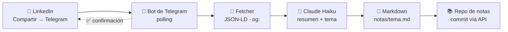
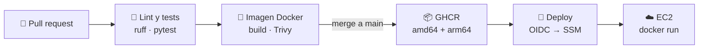
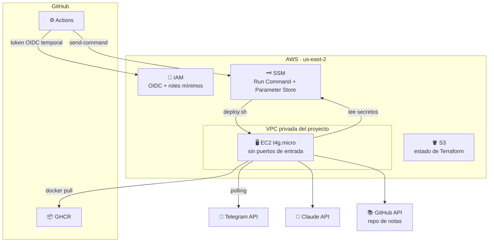

<div align="center">

# 🔖 liked-in

**Convierte los posts de LinkedIn que te gustan en notas de aprendizaje, sin salir del celular.**

Compartes un post a Telegram → Claude lo resume → queda guardado como Markdown en tu repo de notas.

[](https://github.com/martincitouU/liked-in/actions/workflows/ci.yml)


[Cómo funciona](#como-funciona) ·
[Uso diario](#uso-diario) ·
[Puesta en marcha](#puesta-en-marcha) ·
[Ventajas](#ventajas) ·
[Arquitectura](#arquitectura)

</div>

---

## 💡 El problema

Le das *like* o *repost* a decenas de posts útiles en LinkedIn —sobre Kubernetes, AWS, carrera, IA— y a la semana ya no recuerdas ninguno. LinkedIn no tiene una forma cómoda de volver a ellos, y menos de convertirlos en conocimiento ordenado.

**liked-in** hace que guardar un post sea tan fácil como compartirlo, y lo transforma en una nota clara, en español y agrupada por tema.

## ✨ Qué hace

| | |
|---|---|
| 📲 **Captura en un toque** | Desde la app de LinkedIn: *Compartir → Telegram → tu bot*. Nada más. |
| 🔎 **Lee el post completo** | Extrae el texto y el autor de la página pública del post (JSON-LD, con respaldo en Open Graph). |
| 🧠 **Resume con Claude** | Genera título, resumen, ideas clave y etiquetas, en español, sin importar el idioma original. |
| 🗂️ **Organiza por tema** | Reutiliza los temas que ya existen (`kubernetes`, `aws`, `carrera-profesional`…) y mantiene un índice. |
| 📝 **Guarda en Markdown** | Cada nota es un commit en tu repo de notas: historial, búsqueda y portabilidad gratis. |
| 🔁 **Sin duplicados** | Si compartes dos veces el mismo post, el bot te avisa en vez de repetirlo. |

### Así se ve

**En Telegram**, segundos después de compartir:

```text
✅ kubernetes.md · 4 nota(s)

Diferencias entre imagen, contenedor y Pod
Una imagen es la plantilla inmutable, el contenedor es su ejecución y el Pod
es la unidad mínima de Kubernetes que agrupa contenedores que comparten red.

• Un Pod puede tener varios contenedores que comparten IP y volúmenes
• Kubernetes programa Pods, no contenedores sueltos
• Reiniciar un contenedor no recrea el Pod
```

**En tu repo de notas** (`notas/kubernetes.md`):

```markdown
## Diferencias entre imagen, contenedor y Pod

*2026-11-22 · [post original](https://lnkd.in/p/...) · Turf Dev*

Una imagen es la plantilla inmutable, el contenedor es su ejecución y el Pod
es la unidad mínima de Kubernetes que agrupa contenedores que comparten red.

- Un Pod puede tener varios contenedores que comparten IP y volúmenes
- Kubernetes programa Pods, no contenedores sueltos
- Reiniciar un contenedor no recrea el Pod

`#kubernetes` `#pods` `#contenedores`

---
```

<a id="como-funciona"></a>

## 🔄 Cómo funciona



1. **Telegram** entrega el mensaje con el link al bot. El bot solo responde a tu ID de usuario; cualquier otra persona es ignorada.
2. **El fetcher** descarga la página pública del post y saca el texto completo y el autor desde el JSON-LD. Si no está, usa la descripción Open Graph.
3. **Claude** recibe el post y la lista de temas existentes, y devuelve un JSON con `tema`, `titulo`, `resumen`, `ideas_clave` y `etiquetas`.
4. **El pipeline** formatea la entrada, la agrega al archivo del tema y actualiza el índice `README.md` si el tema es nuevo.
5. **El almacenamiento** escribe en una carpeta local (desarrollo) o hace commit en GitHub con la Contents API (producción).

<a id="uso-diario"></a>

## 📱 Uso diario

1. En la app de LinkedIn, abre un post que te sirva.
2. Toca **Compartir** (o **Enviar → Compartir vía**) → **Telegram** → elige tu bot.
3. Espera unos segundos: el bot responde con el tema y el resumen.
4. Revisa tus notas cuando quieras en GitHub, o clona el repo y ábrelo en Obsidian o VS Code.

**Comandos del bot**

| Comando | Qué hace |
|---|---|
| `/start` | Muestra el mensaje de bienvenida |

> [!TIP]
> El repo de notas es Markdown plano: puedes abrirlo como bóveda de **Obsidian** y navegar los temas como un grafo de conocimiento.

<a id="puesta-en-marcha"></a>

## 🚀 Puesta en marcha paso a paso

### Requisitos

- Python 3.12, Git y Docker
- Una cuenta de Telegram
- Una API key de Claude ([platform.claude.com](https://platform.claude.com))
- Una cuenta de GitHub y un repo (vacío) para las notas
- Para producción: una cuenta de AWS, AWS CLI y Terraform ≥ 1.10

<details>
<summary><b>1. Crear el bot de Telegram</b></summary>

1. En Telegram, habla con **@BotFather** → `/newbot`.
2. Elige un nombre y un usuario terminado en `bot`. BotFather te entrega un **token**.
3. Habla con **@userinfobot** para obtener tu **ID numérico**.

> [!IMPORTANT]
> Trata el token como una contraseña. Usa un bot distinto para desarrollo y otro para producción: dos procesos con el mismo token chocan (error 409 de Telegram).

</details>

<details>
<summary><b>2. Obtener las credenciales</b></summary>

- **Claude:** en [platform.claude.com](https://platform.claude.com) → *Settings → API keys → Create key*. Recomendado: un workspace con límite de gasto mensual.
- **GitHub:** crea un *fine-grained token* en *Settings → Developer settings* con acceso **solo** al repo de notas y el permiso **Contents: Read and write**. Nada más.

</details>

<details>
<summary><b>3. Clonar y configurar</b></summary>

```bash
git clone https://github.com/martincitouU/liked-in.git
cd liked-in
python3 -m venv .venv && source .venv/bin/activate
pip install -r requirements-dev.txt
cp .env.example .env    # y completa los valores
```

Variables de entorno:

| Variable | Obligatoria | Descripción |
|---|:---:|---|
| `TELEGRAM_TOKEN` | ✅ | Token del bot entregado por @BotFather |
| `ALLOWED_USER_ID` | ✅ | Tu ID numérico de Telegram; nadie más puede usar el bot |
| `ANTHROPIC_API_KEY` | ✅ | API key de Claude |
| `LLM_MODEL` | | Modelo a usar (por defecto `claude-haiku-5-5`) |
| `STORAGE` | | `local` (por defecto) o `github` |
| `NOTES_LOCAL_DIR` | | Carpeta para las notas en modo local (por defecto `salida/notas`) |
| `GITHUB_TOKEN` | con `github` | Token fine-grained del repo de notas |
| `GITHUB_REPO` | con `github` | Repo de notas, en formato `usuario/repo` |
| `NOTES_DIR` | | Carpeta dentro del repo de notas (por defecto `notas`) |

</details>

<details>
<summary><b>4. Ejecutar en local</b></summary>

Con Python:

```bash
python -m app.bot
```

O con Docker:

```bash
docker compose up --build
```

Comparte un post a tu bot y revisa `salida/notas/` (o tu repo de notas si usas `STORAGE=github`).

¿Quieres probar si un post se puede leer antes de levantar el bot?

```bash
python probar_links.py "https://lnkd.in/p/..."
```

</details>

<details>
<summary><b>5. Tests y calidad</b></summary>

```bash
ruff format . && ruff check .
pytest
```

Los tests no llaman a LinkedIn, Claude ni GitHub: usan HTML de ejemplo, un resumidor falso y un GitHub simulado con `httpx.MockTransport`. Son rápidos, gratuitos y deterministas.

</details>

<details>
<summary><b>6. Desplegar en AWS</b></summary>

**a) Bucket para el estado de Terraform** (una sola vez):

```bash
export AWS_PROFILE=tu-perfil
cd infra/bootstrap
terraform init && terraform apply
```

**b) Infraestructura** (VPC, EC2, roles IAM, OIDC y configuración):

```bash
cd ../
terraform init && terraform apply
```

Anota los outputs `instance_id` y `deploy_role_arn`.

**c) Secretos en SSM Parameter Store** (cifrados, fuera del estado de Terraform):

```bash
aws ssm put-parameter --name /liked-in/TELEGRAM_TOKEN    --type SecureString --value "..."
aws ssm put-parameter --name /liked-in/ALLOWED_USER_ID   --type SecureString --value "..."
aws ssm put-parameter --name /liked-in/ANTHROPIC_API_KEY --type SecureString --value "..."
aws ssm put-parameter --name /liked-in/GITHUB_TOKEN      --type SecureString --value "..."
```

> [!TIP]
> Para que los valores no queden en el historial de la terminal, léelos con `read -s` y pásalos como variable.

**d) Environment de GitHub:** en *Settings → Environments* crea `production`, limítalo a la rama `main` y agrega las variables `AWS_ROLE_ARN`, `AWS_REGION` e `INSTANCE_ID`.

**e) Imagen pública:** en *Packages → liked-in → Package settings*, cambia la visibilidad a **Public** (la imagen no contiene secretos).

Desde ahí, **cada merge a `main` se despliega solo**.

</details>

<a id="ventajas"></a>

## 🌟 Ventajas

<table>
<tr>
<td width="50%" valign="top">

### Para aprender
- ⚡ **Cero fricción.** Guardar es compartir: no hay apps nuevas, formularios ni copiar y pegar.
- 🎯 **Notas accionables.** No guarda el post, guarda lo que vale la pena recordar: resumen e ideas clave.
- 🗂️ **Orden automático.** Los temas se agrupan solos y se reutilizan, con un índice siempre al día.
- 🌎 **Todo en español.** Lee posts en inglés, portugués o cualquier idioma y los resume en tu idioma.

</td>
<td width="50%" valign="top">

### Para tus datos
- 🔓 **Sin lock-in.** Tus notas son Markdown en tu propio repo: portables a Obsidian, Notion o lo que quieras.
- 🕰️ **Historial completo.** Cada nota es un commit: sabes qué guardaste y cuándo.
- 🔐 **Privado por diseño.** El bot solo responde a tu usuario, y el token de GitHub solo puede escribir en el repo de notas.
- 🛡️ **Tu cuenta de LinkedIn intacta.** Solo lee posts públicos: no usa tu sesión ni hace scraping con tu cuenta.

</td>
</tr>
<tr>
<td width="50%" valign="top">

### Para operar
- 💸 **Barato.** Un resumen con Claude Haiku cuesta una fracción de centavo, y la infraestructura completa ronda los US$7 al mes.
- 🤖 **Mantenimiento mínimo.** Cada merge pasa por tests, escaneo de seguridad y deploy automático.
- ♻️ **Reproducible.** Toda la infraestructura está en Terraform: se levanta o se destruye con un comando.

</td>
<td width="50%" valign="top">

### Como proyecto
- 🧰 **Plantilla DevOps real.** CI/CD, contenedores multi-arquitectura, IaC, OIDC y gestión de secretos en un proyecto pequeño y entendible.
- 🧪 **Testeable.** La lógica está separada de los servicios externos, que se reemplazan por dobles en los tests.
- 🔌 **Extensible.** Cambiar dónde se guardan las notas es implementar tres métodos (`list_topics`, `read`, `write`).

</td>
</tr>
</table>

<a id="arquitectura"></a>

## 🏗️ Arquitectura y DevOps

### Pipeline CI/CD



| Etapa | Qué hace | Cuándo |
|---|---|---|
| **Lint y tests** | `ruff check`, `ruff format --check` y `pytest` | Cada PR y cada push a `main` |
| **Imagen Docker** | Build, escaneo con Trivy (falla con vulnerabilidades CRITICAL/HIGH con parche) | Cada PR y cada push a `main` |
| **Publicación** | Imagen multi-arquitectura en GHCR con tags `sha-xxxxxxx` y `latest` | Solo en `main` |
| **Deploy** | Credenciales por OIDC y `deploy.sh` ejecutado en la instancia vía SSM | Solo en `main`, environment `production` |

### Infraestructura en AWS



### Decisiones de seguridad

- **Sin puertos de entrada.** El security group no tiene ninguna regla de entrada, ni siquiera SSH. El bot funciona por *polling* y la administración se hace con SSM, que también conecta desde adentro hacia afuera.
- **Sin access keys.** GitHub Actions entra a AWS con OIDC: un token temporal firmado por GitHub, aceptado solo si viene de **este** repo (por ID inmutable) y del environment `production`.
- **Mínimo privilegio.** El rol de deploy solo puede enviar comandos a esa instancia. El rol de la instancia solo puede leer los parámetros `/liked-in/*`.
- **Secretos fuera del código, de la imagen y del estado.** Viven cifrados en SSM Parameter Store (`SecureString`) y se escriben en un `.env` con permisos de solo root al momento del deploy.
- **Contenedor endurecido.** Imagen `slim`, parches de Debian aplicados en el build, usuario sin privilegios y escaneo de vulnerabilidades antes de publicar.
- **Instancia endurecida.** IMDSv2 obligatorio y disco cifrado.
- **Cadena de suministro.** Las actions se fijan por versión; Trivy usa un release inmutable.

### Stack

| Capa | Tecnología |
|---|---|
| Bot | Python 3.12 · `python-telegram-bot` · `httpx` · `beautifulsoup4` |
| IA | Claude Haiku vía SDK de Anthropic |
| Notas | Markdown en un repo de GitHub (Contents API) |
| Calidad | `pytest` · `ruff` |
| Contenedor | Docker multi-arquitectura (amd64 / arm64) · Trivy |
| CI/CD | GitHub Actions · GHCR · OIDC |
| Infraestructura | Terraform · AWS EC2 (Graviton) · VPC · IAM · SSM · S3 |

### Estructura del repo

```text
liked-in/
├── app/
│   ├── bot.py            # handlers de Telegram y arranque
│   ├── fetcher.py        # lectura del post (JSON-LD / Open Graph)
│   ├── summarizer.py     # prompt y llamada a Claude
│   ├── notes.py          # formato Markdown e índice
│   ├── pipeline.py       # orquesta: resumen → nota → guardado
│   └── storage.py        # LocalStorage y GitHubStorage
├── tests/                # tests sin dependencias externas
├── infra/
│   ├── bootstrap/        # bucket S3 para el estado de Terraform
│   └── *.tf              # VPC, EC2, IAM, OIDC y parámetros
├── deploy/deploy.sh      # se ejecuta en la instancia vía SSM
├── .github/workflows/    # CI/CD
├── Dockerfile
├── docker-compose.yml    # para correrlo en local
└── probar_links.py       # verifica si un post se puede leer
```

## 💰 Costos estimados

| Recurso | US$/mes |
|---|---:|
| EC2 `t4g.micro` (puede quedar cubierto por la capa gratuita) | ~6 |
| IPv4 pública | ~3,6 |
| Disco gp3 de 8 GB | ~0,6 |
| Claude Haiku (≈100 posts al mes) | < 0,5 |
| **Total aproximado** | **~10** |

> [!NOTE]
> Los valores son referenciales y dependen de la región y de los créditos de tu cuenta. Configura una alerta en AWS Budgets.

## 🗺️ Roadmap

- [ ] Leer el texto de las imágenes de los posts (infografías) con la visión de Claude
- [ ] Recibir capturas por Telegram para carruseles y PDF
- [ ] Respaldo de "pégame el texto" cuando el post no se puede leer
- [ ] Comandos `/temas` y `/estado`
- [ ] Avisos de error por Telegram
- [ ] Workflow de rollback a un SHA anterior
- [ ] Build semanal programado para recoger parches de seguridad
- [ ] `terraform plan` automático en los PR que tocan `infra/`
- [ ] Dependabot para dependencias y actions

## ⚠️ Limitaciones

- Solo funciona con **posts públicos**. Si LinkedIn exige iniciar sesión para ver un post, el bot no lo puede leer.
- De los carruseles y documentos PDF, por ahora solo se aprovecha el texto del post, no las páginas.
- El bot procesa los mensajes de a uno: está pensado para uso personal, no para muchos usuarios.

---

<div align="center">

Hecho por [@martincitouU](https://github.com/martincitouU) para dejar de perder lo que aprendo en LinkedIn.

</div>
